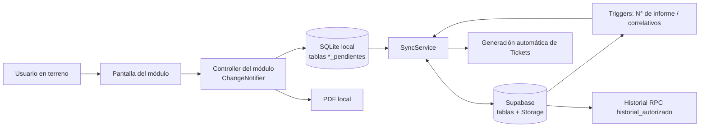

# Arquitectura

> Última revisión: 2026-10-22 · App `0.7.6+62` · DB local versión 62 (`jfinnova_v18_local.db`)

## Stack

| Pieza | Uso |
|---|---|
| Flutter / Dart (`sdk ^3.10.4`) | App única para Android, web e iOS. |
| SQLite (`sqflite`) | Base local: todo se lee y escribe aquí primero (offline-first). |
| Supabase (`supabase_flutter`) | Login, base de datos PostgreSQL central, Storage de fotos y PDFs, triggers de correlativos, RPC de historial. |
| Firebase | **Solo Crashlytics** (registro de errores). |
| Generación de PDF | Local en el dispositivo, en un isolate, con versión propia por tipo de informe. |

## Cómo se conectan las partes



1. **Inicio**: `main.dart` inicializa Firebase (Crashlytics) y Supabase. `AuthGate`
   muestra `LoginScreen` o `HomeScreen` según haya sesión.
2. **Sesión**: `UserSession` (singleton) guarda usuario, rol y empresa activa.
3. **Home**: muestra las tarjetas de módulos habilitados para la empresa
   (`ModuleRegistry` + tabla `empresa_modulos`), los grupos de checklists
   configurables y la lista de borradores.
4. **Módulo**: cada pantalla crea su propio Controller (no hay estado global ni
   Provider). El controller guarda borradores en SQLite con `subido = 0` y
   autoguardado.
5. **Finalizar**: el registro pasa a estado `En Seguimiento`; se intenta
   sincronizar para que Supabase asigne el **número de informe** (trigger). Con
   número real se genera el PDF; sin conexión el PDF queda **diferido** y se genera
   al final del siguiente sync.
6. **Sync** (`SyncService.sincronizarTodo`): sube cabeceras, respuestas, fotos y
   firmas; descarga maestros y catálogos; genera tickets automáticos desde
   inspecciones finalizadas; genera PDFs diferidos.
7. **Consultas online**: Historial y Tickets trabajan directo contra Supabase.

## Estructura de carpetas

```
lib/
  main.dart                 Arranque, AuthGate
  core/
    database/               DatabaseHelper (esquema SQLite y migraciones)
    modules/                ModuleRegistry (tarjetas de Home), colores Hidroser
    services/               UserSession, conectividad, logos de empresa
    config/                 Supabase, localización en español
    utils/                  rut_utils, foco, safe area
    theme/, errors/
  features/<módulo>/        data/ (repositorios), domain/ (modelos, reglas),
                            presentation/ (screens, controllers, widgets),
                            services/ (PDF, sync específico)
  shared/widgets/           Componentes comunes: dropdown, filtros, firma,
                            cámara, diálogo de finalizar, etc.
test/                       Tests por tema (<tema>_test.dart)
supabase_*.sql              Migraciones, seeds, fixes y diagnósticos (no prueban
                            que estén aplicados en la base real)
documentos_checklists/      Documentos fuente de checklists
docs/                       Esta documentación + planificación
```

## Patrones transversales

- **Borradores**: todos los formularios guardan solos (debounce, guardado
  periódico, al salir y al pasar a segundo plano). Los borradores aparecen en la
  lista de Home.
- **Estados de un registro**: `En Progreso` (borrador) → `En Seguimiento`
  (finalizado). Ver [base-de-datos](base-de-datos/README.md#estados).
- **Soft delete**: `eliminado = 1, subido = 0`; el sync borra en Supabase.
- **Correlativos**: los asigna Supabase (triggers/secuencias), nunca la app. Ver
  [decisión](decisiones/numero-informe-por-trigger.md).
- **PDF**: cada generador tiene su versión (ver tabla en
  [decisiones/version-por-pdf.md](decisiones/version-por-pdf.md)).
- **Multiempresa**: módulos habilitados por empresa; un usuario puede pertenecer
  a varias empresas. Ver [acceso-y-empresas](modulos/acceso-y-empresas.md).

## Cómo ejecutar

```bash
flutter pub get
flutter run                 # dispositivo/emulador conectado
flutter run -d chrome       # web
flutter analyze             # obligatorio antes de cerrar un cambio Dart
flutter test                # tests (test/<tema>_test.dart)
flutter build apk --target-platform android-arm64
```

iOS se compila, firma y valida en Mac: [IOS_HANDOFF_MAC_CHECKLIST.md](IOS_HANDOFF_MAC_CHECKLIST.md).

## Pendiente de confirmar

- `docs/planificacion/00_referencia/CONTEXTO_GENERAL.md` describe "Provider
  Pattern" y tablas `ast_registros`/`ast_detalles`; el código actual no usa
  Provider y AST usa `ast_informes`/`ast_hallazgos`. Ese documento está
  desactualizado en esos puntos.
