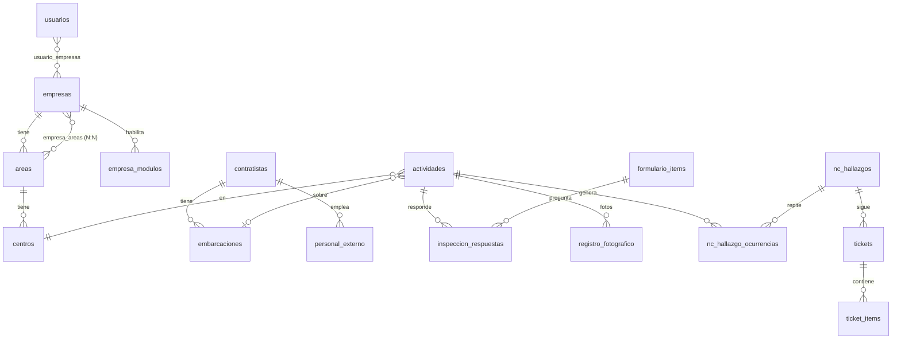

# Base de datos

> Última revisión: 2026-10-22 contra Supabase (lectura) y `lib/core/database/database_helper.dart` (v62).

Hay **dos bases**:

| Base | Para qué | Dónde se define |
|---|---|---|
| **SQLite local** | Todo lo que el usuario crea o consulta en terreno. Tablas `*_pendientes` para registros propios y copias de maestros/catálogos. | `DatabaseHelper` (`_dbVersion`, `onUpgrade`). |
| **Supabase (PostgreSQL)** | Fuente central. Recibe lo sincronizado, asigna correlativos, alimenta Historial, Tickets y dashboards. | Scripts `supabase_*.sql` en la raíz (el script no prueba que esté aplicado). |

Archivos de esta carpeta:

- [maestros.md](maestros.md): empresas, áreas, centros, contratistas, embarcaciones, personal, usuarios.
- [esquema-por-modulo.md](esquema-por-modulo.md): tablas de cada módulo y su relación.

## Relaciones principales

Ideas clave:

- **`actividades`** es la cabecera de las inspecciones de buceo/embarcación y
  también de bitácoras y actividades formativas (`tipo_actividad`).
- **`visitas_tecnicas`** es la cabecera de Registro de Visita, Extintores R-004,
  Vehículos y Mantención PROSESSO.
- Varios módulos tienen **tablas propias** (AST, Hidroser, Merieux, Equipamiento
  de Buceo, Checklists Configurables, Cronograma, Correo).
- **`formulario_items`** es el banco de preguntas de los módulos "clásicos",
  separado por `tipo_actividad`. El motor configurable guarda sus preguntas en
  `checklist_versions.snapshot_preguntas`.

## Estados

Enum `estado_actividad` (Supabase): `Habilitada, Suspendida, Rechazada, En Seguimiento, En Progreso, Finalizada, Eliminada`.

| Estado | Significado en la app |
|---|---|
| `En Progreso` | Borrador. Sin número de informe. |
| `En Seguimiento` | Finalizado por el usuario. Dispara el número de informe (trigger) y queda disponible para Tickets e Historial. |
| `Habilitada` / `Suspendida` / `Rechazada` | Estado de la **faena** de buceo (resultado de verificaciones). Pendiente de confirmar uso exacto de cada uno en la versión actual. |
| `Finalizada`, `Eliminada` | Existen en el enum; pendiente de confirmar dónde se usan. |

Tickets: `tickets.estado` es texto validado por el check `tickets_estado_check`
(`ABIERTO, TOMADO, PARCIAL, FINALIZADO_PENDIENTE_REVISION, CERRADO`), igual que
`TicketEstado` en el código. El enum `estado_ticket` es **legado**: solo lo usa
`ticket_historial` (vacía). Traducción completa en el [glosario](../glosario.md#estados).

## Tipos de respuesta

| Respuesta | Significado | Dónde |
|---|---|---|
| `C` | Cumple | Enum `estado_respuesta`; inspecciones, visitas, Hidroser, PROSESSO, Merieux. |
| `NC` | No cumple. Exige observación (y en algunos módulos foto/criticidad). Genera hallazgo/ticket en inspecciones de buceo y embarcación. | Igual. |
| `N/A` (o `NA`) | No aplica. | Igual. PROSESSO documenta `NA`. |
| Sí / No / No aplica | Motor configurable: se muestran como cumple / no cumple / no aplica en el PDF. | `checklist_respuestas`. |

## Criticidad (dos escalas)

Enum `nivel_criticidad`: `Bajo, Medio, Alto, Intolerable, Tolerable, Moderado`.

- Inspecciones y visitas: `Tolerable / Moderado / Intolerable`.
- Tickets: `Bajo / Medio / Alto / Intolerable`.
- Equivalencia: Tolerable↔Bajo, Moderado↔Medio, Intolerable↔Alto/Intolerable.
- `inspeccion_respuestas.criticidad_registrada` anterior a 2026-03-29 quedó todo
  en "Tolerable": **no usar en métricas**. Ver [decisión](../decisiones/dos-escalas-criticidad.md).

## Columnas y convenciones locales

| Columna / regla | Significado |
|---|---|
| `subido` (SQLite) | `0` = falta subir; `1` = ya sincronizado. |
| `eliminado` (SQLite) | Soft delete; el sync hace el borrado real. |
| `pdf_path_local` | Solo local. Se quita antes de subir (si no, error PGRST204). |
| `numero_informe` | Lo pone el trigger; nunca se envía desde la app. |
| RUT | Normalizado (sin puntos ni guion, minúsculas) en ambas bases. |

## Storage (Supabase)

Buckets usados por el código: `evidencias` (fotos), `reportes` (PDFs de
inspecciones), `pdfs_visitas` (PDFs de visitas). Pendiente de confirmar
buckets de AST, Hidroser y formativas (se suben desde `SyncService`).

## Tablas sin uso visible en la app

`capacitaciones_registros`, `capacitaciones_asistentes`, `ticket_historial`,
`visita_respuestas`: 0 filas al 2026-10-22 y sin referencias claras en `lib/`.
Pendiente de confirmar si son legado.
