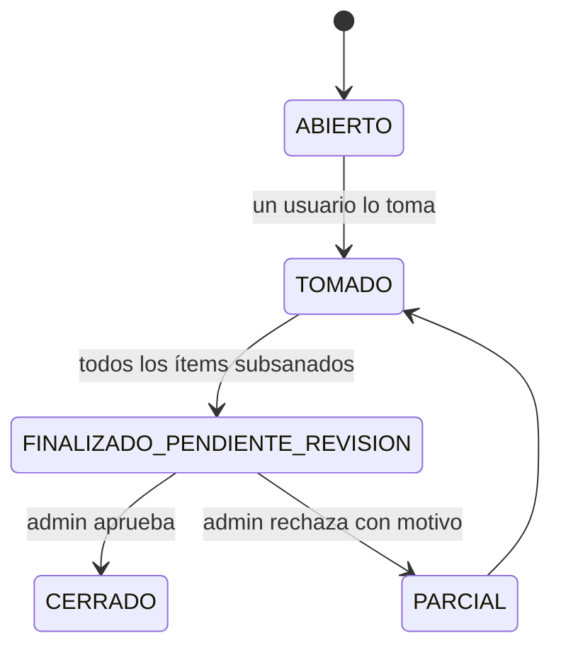

# Tickets

> Clave: `TICKETS` · Estado: en producción · Solo online · Última revisión: 2026-10-22
> Empresas con el módulo (2026-10-22): AquaChile, JF Innova, Servimaf.
> Detalle: [ACTUALIZACION_TICKETS_2026-09-03.md](../planificacion/01_realizados/ACTUALIZACION_TICKETS_2026-09-03.md).

## Qué hace

Seguimiento de **no conformidades** hasta su cierre. Un ticket agrupa las
observaciones a corregir (ítems); alguien lo toma, sube la evidencia de
corrección (subsanación) y un administrador aprueba o rechaza.

## Tipos y origen

- Origen `INSPECCION` (automático) o `SOLICITUD` (manual).
- Tipo `REVISION_OBSERVACIONES` o `SOLICITUD`.

## Ciclo de vida

## Reglas de negocio

- **Generación automática** (en el sync) desde inspecciones de buceo/embarcación
  finalizadas **con embarcación**. Sin embarcación no se genera ticket, pero la
  inspección queda para reprocesar si luego se le asigna. Solo inspecciones
  desde el corte **2026-08-31**.
- **Hallazgo único**: el mismo NC (empresa + tipo de inspección + pregunta +
  embarcación) mientras esté abierto reutiliza hallazgo y ticket, y suma una
  ocurrencia. Otra embarcación = otro contexto.
- **Fotos con observación**: la unidad es la observación escrita. Varias fotos con
  la misma observación = un ítem. Fotos generales, anexos, verificaciones y fotos
  de pregunta no generan tickets.
- Si la inspección tiene 100% de cumplimiento, se pide confirmación antes de
  generar un ticket manual.
- Cada ítem requiere **foto de subsanación**.
- Solo quien tomó el ticket puede finalizarlo. Un ticket sin ítems (solicitud)
  se puede finalizar directamente.
- Eliminar (borrado lógico): el autor o un admin.
- Sin conexión, el módulo muestra un bloqueo (no funciona offline).

## Datos

`nc_hallazgos`, `nc_hallazgo_ocurrencias`, `tickets`, `ticket_items`,
`ticket_item_subsanaciones`, `ticket_historial_tomas`, `ticket_notificaciones`.

## Pantallas

`TicketListScreen` (listado y filtros) → `TicketDetailScreen` (tomar, subsanar,
finalizar, aprobar/rechazar). `TicketGenerarScreen` (desde una inspección) y
`TicketSolicitudFormScreen` (solicitud manual).

## Archivos principales

- `lib/features/tickets/domain/ticket_reglas.dart` (reglas puras)
- `lib/features/tickets/data/repositories/ticket_repository.dart`
- `lib/features/sync/services/sync_service.dart` (`_generarTicketsAutomaticosFinalizados`)

## Pendientes

- [ERRORES_PENDIENTES_TICKETS.md](../planificacion/02_en_progreso/ERRORES_PENDIENTES_TICKETS.md).
- Tickets históricos con estructura antigua no se regeneran.
- Tickets por hallazgo AST (backlog).
- Alertas por fecha de cierre próxima y vínculo con Cronograma (en plan de Cronograma).