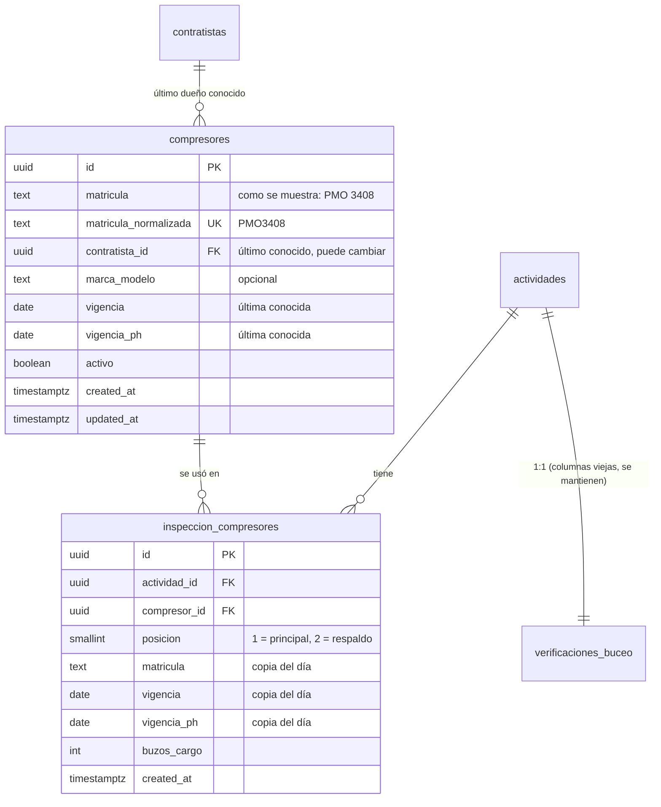

# Propuesta: compresores como registro propio

> **Para qué es:** Análisis y propuesta para guardar los compresores en una tabla propia, con autocompletado por matrícula y sin perder datos.

> Estado: **idea / backlog** (sin alcance aprobado) · Creado: 2026-11-08 · Origen: Mati
> Módulos afectados: [Inspección de buceo y embarcación](../../modulos/inspeccion-buceo-embarcacion.md),
> [Inspección Searov](../../modulos/inspeccion-searov.md), y de forma opcional [Equipamiento de buceo](../../modulos/equipamiento-buceo.md).

## Resumen

| | |
|---|---|
| **Idea** | Tener una tabla de compresores (uno por matrícula) y una tabla que diga qué compresor se usó en cada inspección. Al escribir la matrícula se rellena el resto, igual que con el RUT de los buzos. |
| **¿Es factible?** | **Sí.** No hay vistas, funciones ni triggers en Supabase que lean las columnas de compresores, y en la app solo las usan 4 archivos. |
| **¿Se pierde información?** | **No**, si se hace por fases: primero se agregan las tablas nuevas, se copian los datos y se comparan. Las columnas actuales no se borran hasta comprobar que todo cuadra. |
| **Cambio clave respecto a la idea original** | La vigencia y la P.H. se guardan también **en cada inspección**, no solo en la ficha del compresor. Si no, al renovar un certificado los informes viejos mostrarían la fecha nueva. |
| **Recomendación** | Hacerlo, en 4 fases. Empezar por las fases 1 y 2 (tablas y copia), que no tocan la app. |

---

## 1. Cómo se guarda hoy

### Inspección de buceo (y Searov)

Los compresores son **8 columnas fijas** dentro de `verificaciones_buceo` (una fila por inspección):

| Compresor N°1 | Compresor N°2 (opcional) |
|---|---|
| `compresor_1_matricula` (text) | `compresor_2_matricula` (text) |
| `compresor_1_vigencia` (text) | `compresor_2_vigencia` (text) |
| `compresor_1_vigencia_ph` (text) | `compresor_2_vigencia_ph` (text) |
| `compresor_1_buzos_cargo` (int) | `compresor_2_buzos_cargo` (int) |

- La matrícula es **texto libre**: no hay lista de compresores ni autocompletado.
- Las fechas se guardan como **texto** (`2027-06-26T00:00:00.000`), no como `date`.
- Hay espacio para **2 compresores como máximo**.
- Las fotos del compresor (aceite del principal y del respaldo, bitácora, certificado) van aparte, en
  `registro_fotografico`, como fotos obligatorias (`mandatory_buceo_photo_slot.dart`), y no quedan ligadas a un compresor concreto.

### Equipamiento de buceo (SAL / SAM)

Guarda los compresores como **JSON dentro de `campos_extra`** de `buceo_equipamiento_inspecciones`. Hoy hay
solo 2 inspecciones y ambas tienen los compresores vacíos, así que no hay datos que rescatar.

### Cómo funcionan los buzos (el patrón que se quiere copiar)

- `personal_externo` es la ficha maestra (RUT único, nombre, matrícula, contratista).
- `actividad_participantes` une la inspección con el buzo (`actividad_id`, `personal_id`, rol).
- Al escribir el RUT, `getPersonalByRut()` ([local_inspection_repository.dart](../../../lib/features/inspection/data/repositories/local_inspection_repository.dart#L521)) busca en SQLite y rellena los datos.

> **Ojo con copiar el patrón tal cual:** `actividad_participantes` **no guarda una copia** de los datos del
> buzo, solo apunta a `personal_externo`. Si a un buzo le cambia la matrícula, los informes viejos
> mostrarían la nueva. Con los buzos casi no pasa; con los compresores pasa siempre, porque las
> vigencias se renuevan (ver punto 2).

---

## 2. Lo que dicen los datos reales (Supabase, 2026-11-08)

Período: inspecciones del 2026-01-21 al 2026-11-08 · 805 filas en `verificaciones_buceo`.

| Dato | Valor | Qué significa |
|---|---:|---|
| Inspecciones con compresor N°1 | 741 | Casi todas registran al menos un compresor. |
| Inspecciones con compresor N°2 | 711 | El segundo compresor (respaldo) también es muy común. |
| Matrículas escritas distintas | 226 (N°1) / 212 (N°2) | Tal como se escribieron. |
| **Compresores reales** (matrícula normalizada) | **207** | Una vez juntadas las variantes, son muchos menos. |
| Compresores escritos de más de una forma | **75** | `PMO-3408`, `PMO:3408`, `PMO 3408`… son el mismo equipo. |
| Compresores usados 5 veces o más | 70 | Se repiten mucho: el autocompletado ahorra tipeo de verdad. |
| Más usado | 48 veces | `PMO 4560`, luego `PAR 5375` (47), `PMO 4559` (47). |
| Compresores que aparecen como N°1 **y** como N°2 | 72 | Ser "principal" o "respaldo" depende de la faena, no del compresor. |
| Compresores vistos con más de un contratista | 28 | Arriendo, préstamo o error de tipeo. El contratista no sirve como clave. |
| Compresores con más de una vigencia | 63 | Las vigencias cambian con el tiempo. |
| Vigencia que **sube** entre una inspección y la siguiente | 112 | Renovaciones normales. |
| Vigencia que **baja** entre una inspección y la siguiente | 83 | Casi seguro son errores de tipeo (no se "des-renueva" un certificado). |
| Vigencia **anterior a la fecha de la inspección** | 236 | El certificado estaba vencido, o la fecha está mal escrita. Hay que revisarlo. |
| Matrículas basura o incompletas | ~25 | `NA`, `NOAPLICA`, `1`, `123`, `1223445`, o números sin prefijo como `3408`. |

**Conclusiones:**

1. Hace falta una ficha por compresor. El mismo equipo aparece escrito de 3 o 4 formas, así que hoy no se puede
   saber cuántas veces se inspeccionó un compresor ni si su certificado está al día.
2. Las vigencias tienen que guardarse **por inspección** (lo que se vio ese día) y en la ficha solo como
   "última conocida", para el autocompletado.
3. La posición (principal o respaldo) va en la tabla de unión, no en la ficha del compresor.
4. Las 83 vigencias que bajan y las 236 vencidas son un buen argumento de negocio: con la ficha, la app
   puede avisar "este compresor tenía vigencia hasta X, ¿la actualizas?" y el dashboard puede contar
   faenas con compresor vencido.

---

## 3. Diseño propuesto

### Diagrama

### Tabla `compresores` (la ficha)

- Una fila por compresor real. **Clave única: `matricula_normalizada`** (mayúsculas, sin espacios, guiones,
  puntos ni dos puntos), igual que el RUT con `rut_utils.dart`.
- `vigencia` y `vigencia_ph` son la **última fecha conocida**, solo para rellenar el formulario.
- `contratista_id` es informativo (último dueño visto), sin restricción. Los compresores se tratan como las
  embarcaciones: compartidos, sin `empresa_id`.

### Tabla `inspeccion_compresores` (qué se usó en cada inspección)

- Una fila por compresor usado en una actividad. Única por `(actividad_id, posicion)`.
- Guarda una **copia de lo que se vio ese día** (matrícula, vigencia, P.H., buzos a cargo). El PDF y el
  historial leen de aquí y no cambian aunque después se renueve el certificado.
- `posicion` permite más de 2 compresores en el futuro sin agregar columnas.

### Cómo se vería en el formulario

1. El auditor escribe o elige la matrícula (con sugerencias de compresores ya registrados).
2. Si existe, se rellenan solos la vigencia y la P.H. con la última fecha conocida.
3. El auditor confirma o corrige. Si la cambia, la nueva fecha queda en la inspección y actualiza la ficha.
4. Si la vigencia es anterior a la fecha de la faena, aviso visible ("Certificado vencido").
5. Si la matrícula no existe, se crea la ficha al guardar (como pasa hoy con un buzo nuevo).

---

## 4. Plan por fases (sin perder información)

| Fase | Qué se hace | Toca la app | Riesgo | Se puede volver atrás |
|---|---|:---:|---|---|
| **1. Tablas** | Crear `compresores` e `inspeccion_compresores` en Supabase, con RLS igual a las tablas vecinas. | No | Bajo | Sí, borrando las tablas nuevas |
| **2. Copia de datos** | Llenar las tablas nuevas desde `verificaciones_buceo`. Las columnas viejas **no se tocan**. | No | Bajo | Sí |
| **3. Doble escritura** | La app escribe en las tablas nuevas **y** en las columnas viejas; el formulario autocompleta. SQLite: tablas nuevas + migración (`_dbVersion`), sync en orden (primero `compresores`, después `inspeccion_compresores`). | Sí | Medio | Sí, las columnas viejas siguen completas |
| **4. Lectura desde lo nuevo** | PDF, Searov e historial leen de `inspeccion_compresores`. Las columnas viejas quedan de respaldo hasta que todos los dispositivos tengan la versión nueva. | Sí | Medio | Sí |
| *(5. Limpieza)* | Borrar las columnas viejas. **Solo** cuando nadie use una versión antigua de la app, y con un respaldo previo. | Sí | — | Opcional; se puede no hacer nunca |

### Detalle de la fase 2 (copia de datos)

1. Normalizar cada matrícula (`upper` + quitar todo lo que no sea letra o número).
2. Crear una ficha por matrícula normalizada. Como "matrícula para mostrar" se usa la escritura más repetida y
   como vigencias, las de la inspección más reciente.
3. Crear una fila en `inspeccion_compresores` por cada compresor de cada inspección, **copiando las fechas
   tal como estaban** (aunque parezcan erróneas: es lo que se registró).
4. **No migrar sin revisar** las ~25 matrículas basura (`NA`, `NOAPLICA`, `1`, `123`…) ni las que no tienen
   prefijo (`3408`). Se entrega una lista para decidir caso a caso: unir a un compresor existente, dejar sin
   ficha (solo la copia del día) o descartar.
5. Verificación: que el número de compresores por inspección coincida con las columnas viejas
   (741 + 711, menos las basura descartadas a propósito).

### Puntos del proyecto a cuidar

- **Offline-first:** el autocompletado tiene que funcionar sin señal. Hay que descargar `compresores` en
  `descargarDatosMaestros()` (con try/catch como las demás tablas) y guardarlo en SQLite.
- **Compresor nuevo creado offline:** se usa un id generado en el dispositivo (uuid) y `subido = 0`. Si dos
  dispositivos crean la misma matrícula, el upsert por `matricula_normalizada` los tiene que juntar. Este es el
  punto técnico más delicado.
- **PDFs:** cambiar de dónde leen los datos sube el patch de versión de cada generador afectado (inspección de
  buceo y Searov).
- **Dashboard** (`jf_innova_web/dashboard-jfinnova`): hoy no usa compresores, ni en su código ni en vistas o funciones
  de Supabase (revisado el 2026-11-08). Anotado en [PENDIENTES_DASHBOARD.md](PENDIENTES_DASHBOARD.md#4-compresores-si-se-implementa-la-propuesta).

---

## 5. Alternativas consideradas

| Opción | Pros | Contras | Veredicto |
|---|---|---|---|
| **A. Ficha + unión con copia del día** (esta propuesta) | Historial correcto, autocompletado, permite N compresores, sirve para el dashboard. | Más trabajo: 2 tablas, sync y migración. | **Recomendada** |
| B. Ficha + unión sin copia (igual que buzos) | Más simple. | Al renovar una vigencia se reescriben los informes viejos. Rompe el historial. | Descartada |
| C. Solo ficha para autocompletar y mantener las columnas actuales | Muy poco trabajo: no hay migración de datos, solo una tabla y el autocompletado. | Sigue el límite de 2 compresores, no hay vínculo real con la inspección y el conteo por compresor sigue con normalización a mano. | Sirve como **paso rápido** si no hay tiempo para A |

> La opción C es compatible con A: si se hace C primero, la ficha `compresores` ya queda creada y
> A solo agrega `inspeccion_compresores` después.

---

## 6. Relación con otros pedidos

- **Reunión 29-10-2026, anexo de compresor de respaldo (AquaChile):** pide un anexo con los datos y 6 a 8
  fotos del compresor N°2. Con `inspeccion_compresores` ese anexo lee la fila con `posicion = 2`, y más
  adelante se pueden ligar las fotos al compresor (por ejemplo, `registro_fotografico` con
  `inspeccion_compresor_id`).
- **Equipamiento de buceo (SAL/SAM):** podría usar la misma ficha `compresores` para autocompletar. No es
  urgente: tiene 2 inspecciones y sin compresores cargados.

---

## 7. Preguntas abiertas (para decidir antes de implementar)

1. ¿Se quiere guardar algo más de cada compresor? (marca, modelo, número de serie, fecha de última mantención…)
2. ¿Quién puede corregir una ficha de compresor: cualquier auditor desde el formulario o solo un admin?
3. ¿Qué hacer con las ~25 matrículas basura? (se revisan una por una con la lista de la fase 2)
4. ¿Un compresor vencido debe **bloquear** la inspección, solo avisar o generar un hallazgo o ticket?
5. ~~¿El dashboard consulta Supabase directamente?~~ Sí, pero no usa compresores (2026-11-08). La fase 5 no depende del dashboard.
