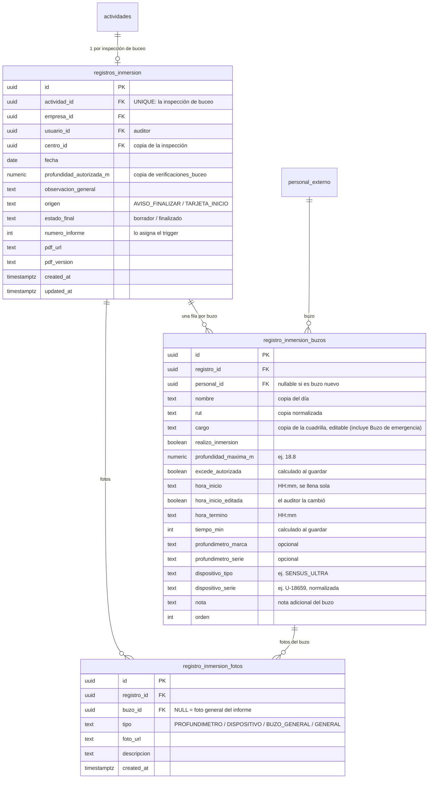

# Propuesta: Registro de inmersiones (AquaChile)

> **Para qué es:** Diseño del registro de inmersiones de buceo: qué datos guarda, cómo se vincula a la inspección de buceo, numeración, PDF y métricas para el dashboard.

> Estado: **idea definida, sin implementar** · Creado: 2026-11-08 · Actualizado: 2026-11-08 (respuestas de Mati) ·
> Origen: reuniones 24-08 y 29-10-2026, explicación de Mati
> Alcance: AquaChile, inspección de buceo (`INSPECCION_BUCEO`) · Relacionado:
> [reunión 29-10](../../1.%20Cosas/REUNIONES/REUNION-29-10-2026.md) ·
> [conversación agosto §4](../02_en_progreso/CONVERSACION_REUNIONES_AGOSTO_2026.md#4-registro-de-inmersiones-de-buceo) ·
> [pendientes del dashboard](PENDIENTES_DASHBOARD.md)

## Resumen

| | |
|---|---|
| **Qué es** | Informe con una fila por buzo de la faena: cargo, si buceó, profundidad máxima, desde–hasta, nota y fotos (profundímetro, registrador Sensus Ultra, general del buzo y galería general). Es la evidencia de cuánto bajó cada buzo. |
| **Quién y cuándo** | El auditor en terreno, al terminar la inspección de buceo, con los datos de la bitácora. La app se lo ofrece al finalizar la inspección. |
| **Qué reemplaza** | Los datos de inmersión que hoy los auditores escriben en el cuerpo del correo (y el registro que Paola arma aparte). |
| **Reglas** | 1 registro por inspección de buceo · **solo se crea vinculado a una inspección**, y lo hace el auditor que hizo la inspección · se anota la profundidad máxima del día · **ninguna foto obligatoria** · sin firma · sin envío por correo · correlativo propio. |
| **Recomendación** | Módulo propio (tarjeta "Registro de inmersiones"), no checklist del motor: no son preguntas C/NC/N/A sino datos por buzo con fotos. |

El PDF de la inspección de buceo (DPR24) no cambia.

---

## 1. Cómo es hoy

### El papel (ejemplo real, Punta Ganso, 31/07/2026)

| N° | Nombre del buzo | RUT | Profundidad máxima (m) | Foto del profundímetro | Foto del dispositivo |
|---|---|---|---|---|---|
| 1 | Leonidas A. Montecinos V. | 13.167.780-4 | 21 m | Scubapro con lectura | Sensus Ultra `U-18659` |
| 2 | César B. Ayancán R. | 13.739.338-7 | 18,8 m | Scubapro con lectura | Sensus Ultra `U-18496` |
| 3 | Juan C. Barrientos T. | 13.825.639-1 | **Buzo de emergencia** | — | — |

Encabezado: centro y fecha. Pie: "Datos extraídos desde bitácoras".

### Flujo en terreno

1. El auditor hace la **inspección de buceo** en la app (cuadrilla, verificaciones, checklist).
2. Con la bitácora, anota la profundidad máxima de cada buzo y fotografía el profundímetro y el registrador.
3. Hoy esos datos van **escritos en el correo**. Con este registro quedan en la app y en un PDF.

### Lo que la app ya tiene y se reutiliza

| Dato | Dónde está hoy | Uso en el registro |
|---|---|---|
| Buzos de la faena | `actividad_participantes` (rol `Buzo`, `Supervisor`, `Asistente`…) + `personal_externo` (nombre, RUT, matrícula) | Se cargan solos al elegir la inspección, con su cargo. |
| Centro, fecha, contratista | `actividades` | Encabezado del registro. |
| Profundidad máxima **planificada** | `verificaciones_buceo.profundidad_maxima` (805 de 805 inspecciones la tienen) | Se compara con la real de cada buzo: **alerta si se supera**. En el ejemplo, 21 m sería un exceso si la faena era de 20 m. |
| Numeración por empresa | `numeradores_informe` + `next_numero_informe` | Contador propio del registro. |

---

## 2. ¿Es más trabajo para el auditor?

**Debería ser igual o menos:**

1. **Los buzos vienen cargados** de la inspección: no se escriben de nuevo nombre, RUT ni cargo. Solo se ingresa la
   profundidad (y lo demás que quiera agregar).
2. **Ninguna foto es obligatoria.** Ninguna nota de las reuniones lo exige. El dashboard puede mostrar el % de buzos con
   evidencia para ver si se están sacando.
3. **La app lo ofrece al finalizar la inspección** y abre el registro ya vinculado, sin buscar nada.
4. Se puede llenar **offline** y en partes (borrador), como el resto de la app.

Los datos de la bitácora se siguen pasando a mano, pero ahora a la app en vez del correo, y el correo queda más corto.

---

## 3. Diseño propuesto

### Cómo se llega al registro

**A. Al finalizar la inspección de buceo (camino principal).** Cuando la inspección se guarda como finalizada sin
errores, sale un aviso: *"¿Quieres hacer el registro de inmersiones ahora?"* → **Sí** abre el formulario ya vinculado a
esa inspección · **Más tarde** cierra el aviso.

- El aviso sale solo si la empresa tiene el módulo habilitado y la inspección no tiene ya un registro.
- **No espera a que la inspección esté subida.** El vínculo es local (`actividad_id`), así que funciona sin señal; si
  se esperara al sync, en terreno sin internet el aviso no saldría nunca. El número y el PDF se resuelven en el sync,
  como en el resto de la app.

**B. Desde la tarjeta "Registro de inmersiones" en Inicio (para "Más tarde").** Abre la lista de **mis inspecciones de
buceo** del dispositivo, las más recientes primero, marcando cuáles ya tienen registro. Solo aparecen las del propio
auditor (las que están en su teléfono).

### El formulario

1. Encabezado: centro, fecha, contratista, N° de inspección (si ya lo tiene) y profundidad autorizada.
2. **Una fila (tarjeta) por buzo**, cargada desde la cuadrilla con los de rol `Buzo`; los demás de la cuadrilla se
   pueden agregar con un botón, y también un buzo que no estaba en la cuadrilla.

   | Campo | Tipo | Notas |
   |---|---|---|
   | Cargo | Lista, viene de la cuadrilla y se puede cambiar | Buzo, Supervisor, Asistente… y **Buzo de emergencia**. |
   | ¿Buceó? | Sí / No | Si es "No", no se piden profundidad ni tiempo. |
   | Profundidad máxima | Número en metros, con decimales | Se marca en rojo si supera la autorizada. |
   | Desde | Hora, **se llena sola** y se puede cambiar | Ver "Tiempo" abajo. |
   | Hasta | Hora | El tiempo de inmersión se calcula solo. |
   | Fotos | Profundímetro · dispositivo · general del buzo | Todas opcionales. |
   | Equipo (opcional) | Marca y serie del profundímetro, serie del registrador | Para una futura tabla de equipos. |
   | Nota adicional | Texto libre | Cualquier comentario sobre ese buzo. |

3. Galería general del informe y observación general.
4. **Finalizar** → número y PDF, como en los demás módulos (en Supabase, con PDF diferido si se finaliza offline).

### Tiempo: desde–hasta (decidido)

- **Desde se llena solo**, como la hora de inicio en las demás inspecciones, y el auditor la puede corregir.
  Propuesta de qué hora poner: la **hora de inicio de la inspección de buceo** (`verificaciones_buceo.hora_inicio`).
  No la hora en que se abre el registro, porque el registro se llena después de la inmersión y esa hora siempre
  quedaría tarde.
- **Hasta** lo pone el auditor con la bitácora.
- El **tiempo de inmersión en minutos** se calcula solo al guardar (si "hasta" es menor que "desde", se asume que cruzó
  la medianoche).
- Se guarda si el "desde" quedó como vino o el auditor lo cambió, para saber en el dashboard qué tan confiable es.

### Datos (todo estructurado, pensado para el dashboard)

Por qué así:

- **Copias del día** (nombre, RUT, cargo, profundidad autorizada): el informe no cambia si después se edita la ficha del
  buzo o la cuadrilla.
- **Cargo + ¿buceó?** en vez de un "motivo": "Buzo de emergencia" es un cargo, y un buzo de emergencia que sí tuvo que
  bajar queda bien registrado (cargo de emergencia, buceó = sí).
- **Tiempo:** las horas tal cual (`hora_inicio`, `hora_termino`, formato `HH:mm` como en `verificaciones_buceo`) y el
  valor en minutos (`tiempo_min`, para métricas sin recalcular).
- **Fotos con `tipo`**: cubre "foto por buzo" y "galería general" a la vez, y permite contar la evidencia faltante.
- **Serie del dispositivo normalizada** (`U18659`): si después se quiere una tabla de equipos (como la de compresores),
  los datos ya están listos para juntarse.
- `excede_autorizada` se guarda calculado para que el dashboard no tenga que recalcular.
- `origen` dice si el registro se hizo desde el aviso o desde Inicio, para medir si el aviso sirve.
- En SQLite: las mismas tablas con `subido` / `eliminado` y rutas locales de fotos, como el resto de los módulos.

### Numeración (correlativo propio)

| Opción | Ejemplo | Pros | Contras |
|---|---|---|---|
| Mismo número que la inspección | Registro N° 1234 = Inspección N° 1234 | Simple de leer. | No es un correlativo propio. Dos documentos distintos con el mismo número generan confusión. |
| Compuesto | `1234-1` | Se ve la inspección de un vistazo. | Con 1 registro por inspección, el sufijo siempre es "-1". Si la inspección todavía no tiene número (finalizada offline), el registro tampoco puede tenerlo. |
| **Propio + referencia** (recomendado) | `RI-0057` · "Inspección de buceo N° 1234" en el encabezado | Sigue la [decisión de numeración por empresa](../../decisiones/numeracion-por-empresa.md) (contador `REGISTRO_INMERSIONES` en `numeradores_informe`). El vínculo queda en el PDF y en la base (`actividad_id`). | Hay que mostrar los dos números en el PDF. |

Si la inspección todavía no tiene número cuando se finaliza el registro, el PDF se genera después del sync (como los
PDF diferidos de hoy) para que salgan los dos números.

### PDF

- Encabezado: "Registro de inmersiones", N° propio, **N° de la inspección de buceo vinculada**, centro, fecha,
  contratista y profundidad autorizada.
- Tabla como la del papel: N°, buzo, RUT, cargo, profundidad máxima (resaltada si supera la autorizada), desde–hasta y tiempo, foto del
  profundímetro y foto del dispositivo. "No buceó" en lugar de la profundidad cuando corresponde.
- Notas por buzo (si hay), foto general de cada buzo (si hay), galería general y observación general.
- Pie: "Datos extraídos desde bitácoras". **Sin firmas.**
- Versión propia del generador, como todos los PDF (v0.1.0).

---

## 4. Datos para el dashboard (qué permite medir)

| Métrica | Cómo sale |
|---|---|
| Profundidad máxima por buzo, centro, contratista y mes | `profundidad_maxima_m` + centro y contratista de la inspección |
| **Inmersiones que superan la profundidad autorizada** | `excede_autorizada = true` |
| Inmersiones por buzo (frecuencia y exposición) | conteo por `personal_id` / `rut` con `realizo_inmersion = true` |
| Tiempo de inmersión por buzo y faena, y a qué hora se bucea | `tiempo_min`, `hora_inicio` |
| Faenas con buzo de emergencia, y cuántas veces tuvo que bajar | `cargo = 'Buzo de emergencia'` + `realizo_inmersion` |
| Evidencia (% de buzos que bucearon con foto de profundímetro y dispositivo) | fotos por `tipo` |
| Inspecciones de buceo **sin** registro de inmersiones | `actividades` sin fila en `registros_inmersion` |
| Uso del aviso al finalizar | `origen` |
| Uso de registradores (qué Sensus usó cada buzo) | `dispositivo_serie` |

Anotar en [PENDIENTES_DASHBOARD.md](PENDIENTES_DASHBOARD.md) cuando se implemente.

---

## 5. Plan por fases

| Fase | Qué se hace | Dónde |
|---|---|---|
| 0. Confirmar | Preguntas abiertas (abajo). | Reunión |
| 1. Base | Tablas en Supabase (RLS como los módulos vecinos), contador `REGISTRO_INMERSIONES`, trigger de número, bucket de fotos. | Supabase (skill `migracion-supabase`) |
| 2. App | Tablas SQLite y migración (`_dbVersion`), módulo en `ModuleRegistry`, lista de inspecciones, formulario, borrador, sync y PDF. Aviso al finalizar la inspección de buceo. | App (skill `nuevo-modulo`) |
| 3. Habilitar | Módulo para AquaChile en `empresa_modulos`, para todos sus auditores. | Supabase |
| 4. Dashboard | Métricas de la sección 4. | Dashboard |

Módulo de referencia para copiar el patrón: el que tenga formulario con fotos y PDF diferido más parecido; a definir
con la skill `nuevo-modulo`, que revisa primero si basta con un checklist del motor (aquí no basta: hay datos por buzo).

---

## 6. Excluido del alcance

- Envío por correo (descartado para todo hasta nuevo aviso).
- Firmas.
- Fotos obligatorias.
- Registro sin inspección de buceo vinculada, o de una inspección hecha por otro auditor u otro teléfono.
- Cambios al PDF de la inspección de buceo (DPR24).
- Inspecciones de otras empresas o Searov (se puede habilitar después).

## 7. Decisiones tomadas (2026-11-08)

- 1 registro por inspección; se anota solo la profundidad máxima.
- Fotos: profundímetro, dispositivo, general del buzo y galería general; ninguna obligatoria.
- Sin firma ni correo; correlativo propio, vinculado a la inspección.
- Solo se crea vinculado a una inspección del propio auditor; la app lo ofrece al finalizar la inspección.
- Por buzo: cargo, ¿buceó?, nota adicional y tiempo **desde–hasta**, con el "desde" automático.
- Numeración: correlativo propio `RI-NNNN` + N° de la inspección de buceo en el encabezado.
- Lo usan **todos los auditores** de AquaChile desde el inicio (no solo Paola).
- Guardar todos los datos posibles, estructurados, para el dashboard.

## 8. Preguntas abiertas

1. ¿El "desde" automático es la hora de inicio de la inspección de buceo? (propuesta; ver "Tiempo")
